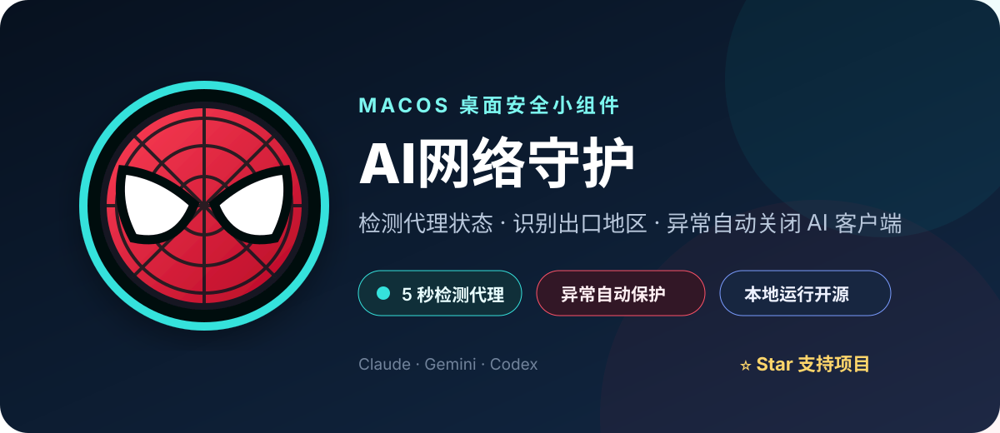
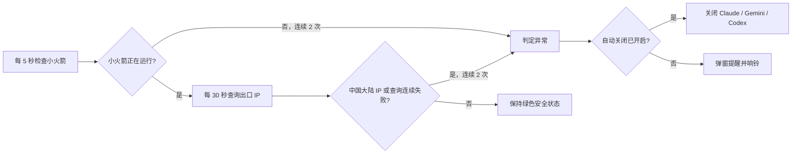

<div align="center">



# AI网络守护

**一个守在桌面上的 macOS 代理状态安全小组件。**  
检测小火箭是否运行、查询当前出口 IP；代理未打开、出口落在中国大陆或网络检测持续失败时，自动关闭 Claude、Gemini 和 Codex，减少意外直连风险。

[](https://github.com/Jerryname05/ai-network-guard-macos)
[](https://www.swift.org/)
[](https://github.com/Jerryname05/ai-network-guard-macos/stargazers)
[](https://github.com/Jerryname05/ai-network-guard-macos)

如果它对你有帮助，欢迎点击右上角 **Star ⭐**，让更多需要代理保护的人看到它。

</div>

## 为什么需要它？

使用 AI 桌面客户端时，代理可能被误关、意外退出或暂时断开。AI网络守护常驻桌面，用一个可拖动的蜘蛛侠悬浮球持续展示状态，并在异常持续出现时执行保护动作。

## 保护逻辑



> “小火箭已运行”不等于代理隧道一定连通，因此程序还会结合出口 IP 检测。两项检测共同提供更可靠的提醒，但仍不是系统级 Kill Switch。

## 功能一览

| 功能 | 说明 |
|---|---|
| 🕷️ 蜘蛛侠悬浮球 | 可拖动，点击展开或收起详情；外圈颜色表示状态 |
| 🚀 小火箭检测 | 每 5 秒检查 Shadowrocket 是否正在运行 |
| 🌍 出口 IP 检测 | 每 30 秒读取 IP、地区、ASN 和运营商 |
| 🇨🇳 地区保护 | 中国大陆出口连续命中 2 次后判定异常；港澳台排除 |
| 🛡️ 自动保护 | 异常时关闭 Claude、Gemini、Codex；也可选择仅提醒 |
| 🔎 Ping0 详情 | 一键打开网页查看 IP 纯净度和风控值 |
| 🔒 本地运行 | 不读取账号、文件或对话内容 |

## 构建与运行

要求：macOS，已安装 Xcode Command Line Tools。

```bash
git clone https://github.com/Jerryname05/ai-network-guard-macos.git
cd ai-network-guard-macos
./build.sh
open "dist/AI网络守护.app"
```

`build.sh` 会编译源码、运行内置规则测试，并对应用进行本地临时签名。

## 使用方法

1. 启动 Shadowrocket 并连接代理。
2. 打开 `AI网络守护.app`。
3. 点击蜘蛛侠悬浮球查看当前出口 IP 和地区。
4. 勾选“异常时自动关闭三个客户端”以启用自动保护。
5. 需要查看 IP 纯净度时，点击“Ping0 详情”。

## 状态颜色

- 🟢 **青绿色**：小火箭运行且未命中中国大陆规则。
- 🟠 **橙色**：首次异常或正在等待第二次确认。
- 🔴 **红色**：异常已连续确认，进入提醒或自动关闭状态。

## 重要限制

- Ping0 免费接口只返回 IP、地区、ASN 和运营商；纯净度/风控值需在 Ping0 网页查看。
- 本工具检测的是自身请求看到的出口。若 Shadowrocket 按应用分流，目标客户端可能使用不同出口。
- 定时检测存在数秒延迟，不能替代系统级断网保护或 Shadowrocket 的 Kill Switch。
- 自动关闭可能导致未保存内容丢失；首次使用建议先保持“仅提醒”。
- 查询失败可能来自 Ping0 临时异常，并不必然代表代理断开。

## 隐私

应用不会上传文件、账号或对话内容。为查询出口网络信息，它会请求 `https://ping0.cc/geo`；该服务会自然看到请求的出口 IP。

## Star History

[](https://star-history.com/#Jerryname05/ai-network-guard-macos&Date)

## 许可

当前仓库暂未授予开源许可证：代码公开可查看，但未经许可不得复制、修改或再分发。如希望采用标准开源许可证，可提交 Issue 讨论。
